# RENDU : Cours assisté 1

Salihu Armend

## Module 1 : le projet PHP et Composer

### Captures

Composer validate et composer install :

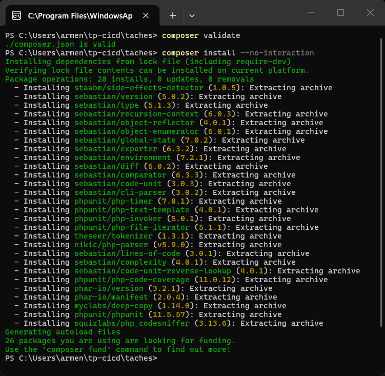

L'autoload avec ma nouvelle règle (test avec "1234") :

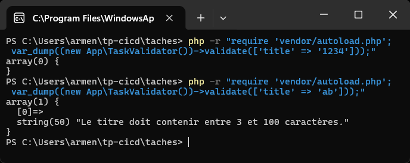

Git log et git status :

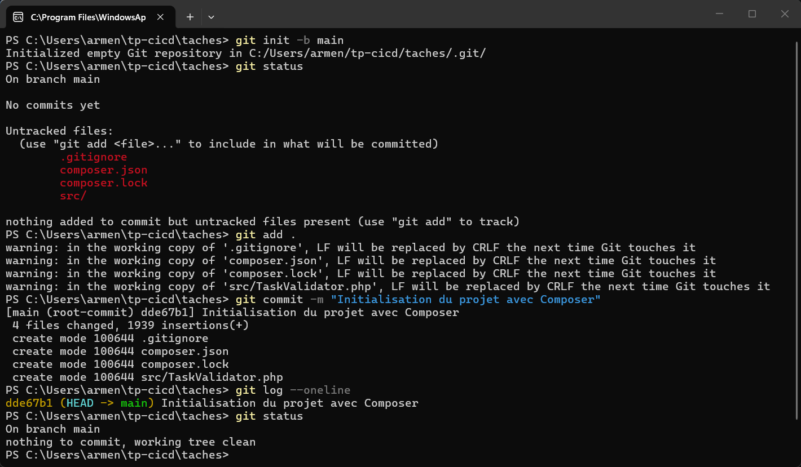

### Ma règle

J'ai ajouté une règle : un titre avec seulement des chiffres est refusé. Le message est : "Le titre doit contenir des lettres."

### Questions

**1. Quelle est la différence entre composer.json et composer.lock ? Pourquoi versionner les deux ?**

Dans composer.json, je dis quels paquets je veux (par exemple PHPUnit 11.5 ou plus). Dans composer.lock, Composer écrit les versions exactes qu'il a installées. On met les deux dans Git pour que tout le monde ait les mêmes versions, même la CI.

**2. Pourquoi vendor/ n'est-il pas versionné ? Comment un collègue (ou la CI) le récupère-t-il ?**

Le dossier vendor/ est très gros et on peut le refaire à tout moment. Donc on ne le met pas dans Git. Un collègue ou la CI fait juste `composer install` et le dossier revient.

**3. À quoi sert config.platform.php ? Que pourrait-il se passer sans ce réglage ?**

Il dit à Composer de travailler comme si on avait PHP 8.3.0. Moi j'ai PHP 8.4 sur mon ordinateur, mais la CI utilise PHP 8.3. Sans ce réglage, Composer pourrait choisir une version qui ne marche pas avec PHP 8.3, et la CI pourrait échouer.

## Module 2 : le code applicatif et la base MySQL

### Captures

MySQL démarré avec Docker Compose (état healthy) :

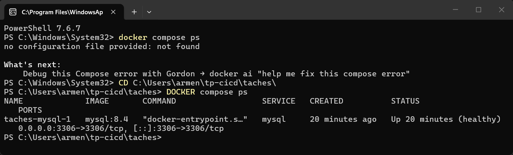

Les appels à l'API avec curl (création 201, refus 422, PATCH réussi, PATCH sur 9999 = 404) :

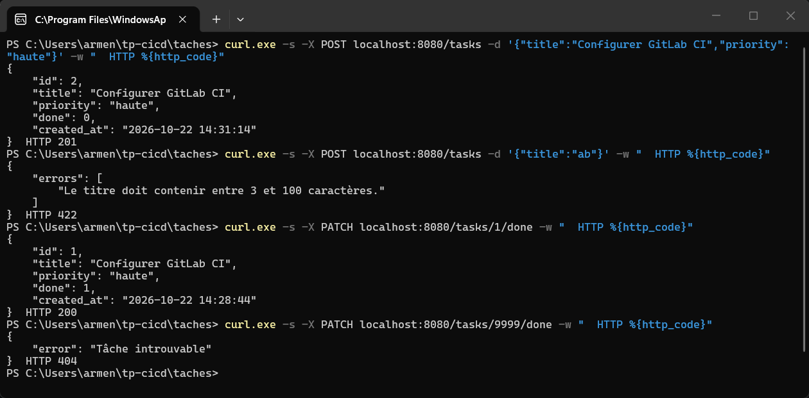

Les tâches dans la base MySQL :

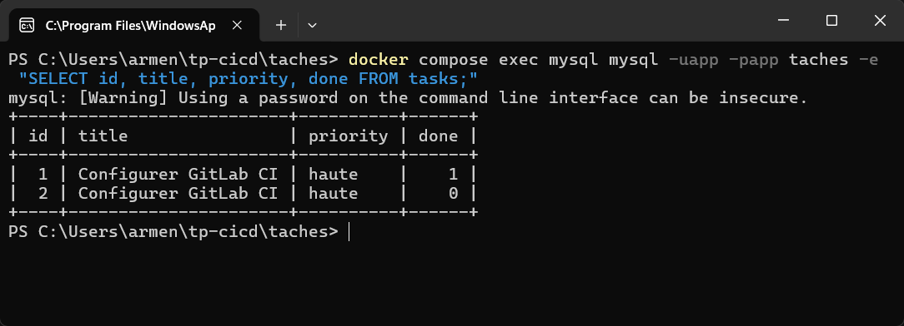

### Mon exercice

J'ai écrit la méthode `markDone()` dans `TaskRepository`. Elle met `done` à 1 et renvoie `true` si une ligne a changé. Si la tâche n'existe pas, elle renvoie `false` et l'API répond 404.

### Questions

**1. Pourquoi la configuration de la base passe-t-elle par des variables d'environnement plutôt que d'être écrite dans le code ?**

L'adresse de la base change selon l'endroit : `127.0.0.1` sur mon ordinateur, `mysql` dans GitLab CI. Avec des variables d'environnement, le code reste le même et on change seulement la configuration. Cela évite aussi de mettre des mots de passe dans le code et dans Git.

**2. Qu'est-ce qu'une requête préparée, et contre quelle attaque protège-t-elle ?**

Une requête préparée envoie le SQL d'un côté et les valeurs de l'autre (par exemple `:id`). La base traite toujours la valeur comme une simple donnée, jamais comme du SQL. Elle protège contre l'injection SQL, par exemple si quelqu'un écrit `1 OR 1=1`.

**3. Pourquoi seul le dossier public/ doit-il être exposé par le serveur web ?**

Le dossier `public/` contient seulement le point d'entrée `index.php`. Les dossiers `src/` et `vendor/` et les fichiers de configuration ne doivent pas être accessibles depuis le navigateur, sinon quelqu'un pourrait lire le code ou des informations secrètes.

## Module 3 : tests automatisés et qualité du code, en local

### Captures

Sans MySQL (arrêté avec `docker compose stop mysql`) : les 6 tests unitaires passent, les 4 tests d'intégration échouent (connexion refusée) :

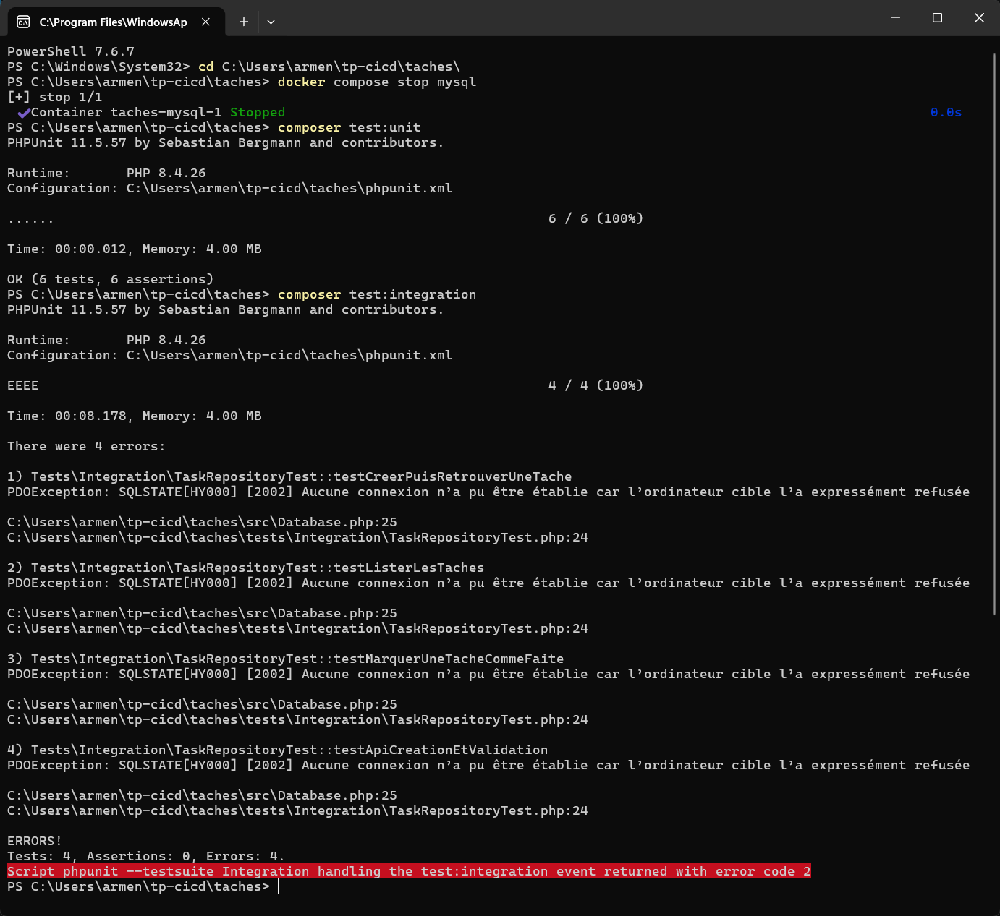

Mon test qui échoue volontairement (une lettre du message modifiée) :

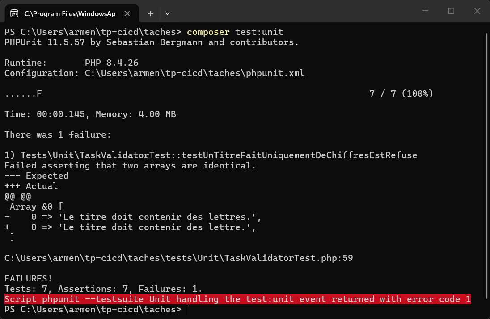

PHP_CodeSniffer détecte les erreurs de style (`composer lint`), puis `phpcbf` les corrige :

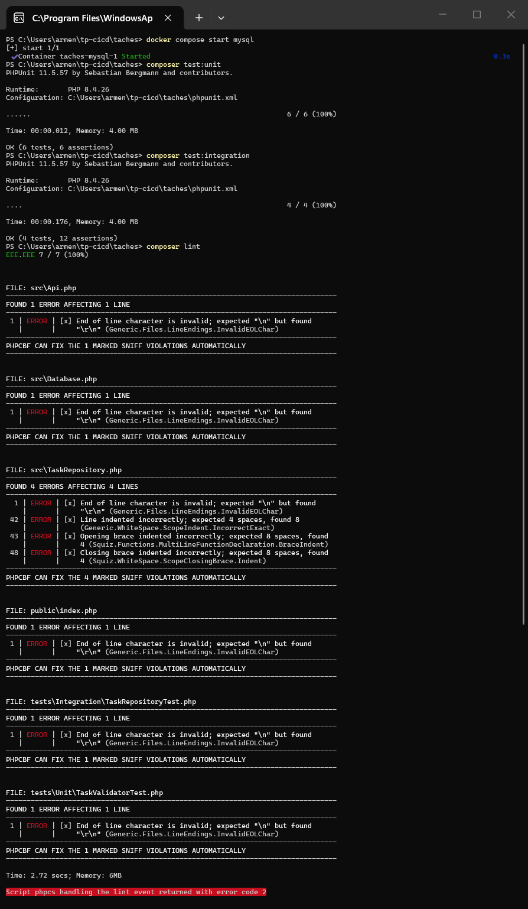

Avec MySQL démarré : tests unitaires, tests d'intégration et lint, tous verts :

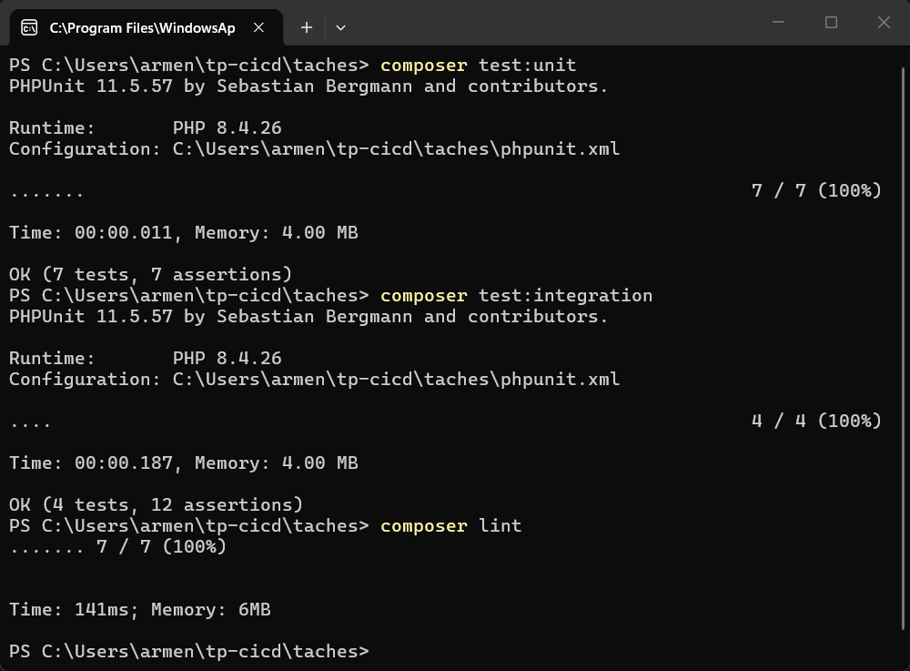

### Mon exercice

J'ai écrit le test unitaire de ma règle du module 1 dans `TaskValidatorTest` :

```php
public function testUnTitreFaitUniquementDeChiffresEstRefuse(): void
{
    $errors = $this->validator->validate(['title' => '1234']);
    $this->assertSame(['Le titre doit contenir des lettres.'], $errors);
}
```

Je l'ai d'abord fait échouer en changeant une lettre du message (« lettres » devenu « lettre ») : PHPUnit affiche la différence entre le message attendu (Expected) et le message obtenu (Actual), puis un code de sortie 1. Après correction, il y a 7 tests unitaires qui passent, 4 tests d'intégration et le lint est vert.

### Questions

**1. Expliquez avec vos mots la différence entre un test unitaire et un test d'intégration. Donnez un bug que seul un test d'intégration détecterait.**

Test unitaire vérifie une seule classe.

Un test d'intégration vérifie plusieurs pièces ensemble avec une vraie base MySQL (le dépôt, le SQL, le schéma, l'API).

pour example une bug dans dans une requête de task repository il peu passer le test unitaire mais le test d’intégration il trouve le bug .

**2. Pourquoi le setUp() crée-t-il la table et la vide-t-il ?**

Pour commencer chaque test avec une base vide. Les tests ne se gênent pas entre eux. En CI, la base est nouvelle, donc il faut aussi créer la table.

**3. Quel est le code de sortie d’une commande qui échoue ? Pourquoi est-ce important en CI ?**

Une commande réussie renvoie 0. Si elle échoue, elle renvoie un autre nombre. La CI utilise ce code pour voir les erreurs et bloquer la livraison.

## Module 4 : premier pipeline

### Captures

Runner GitHub utilisé par le pipeline (ubuntu-24.04, runner hébergé par GitHub, aucun jeton visible) :

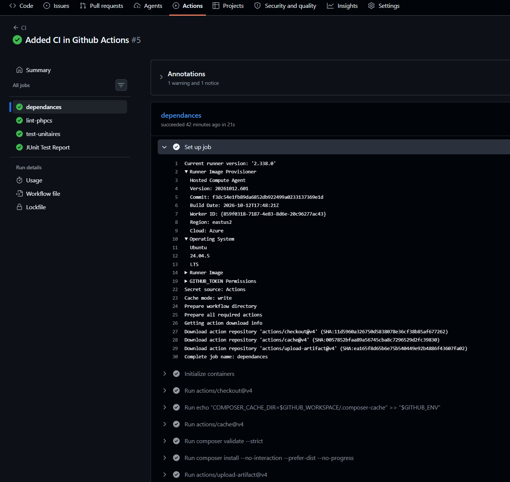

Le pipeline vert : 3 jobs (dependances, lint-phpcs, test-unitaires) et 7 tests réussis :

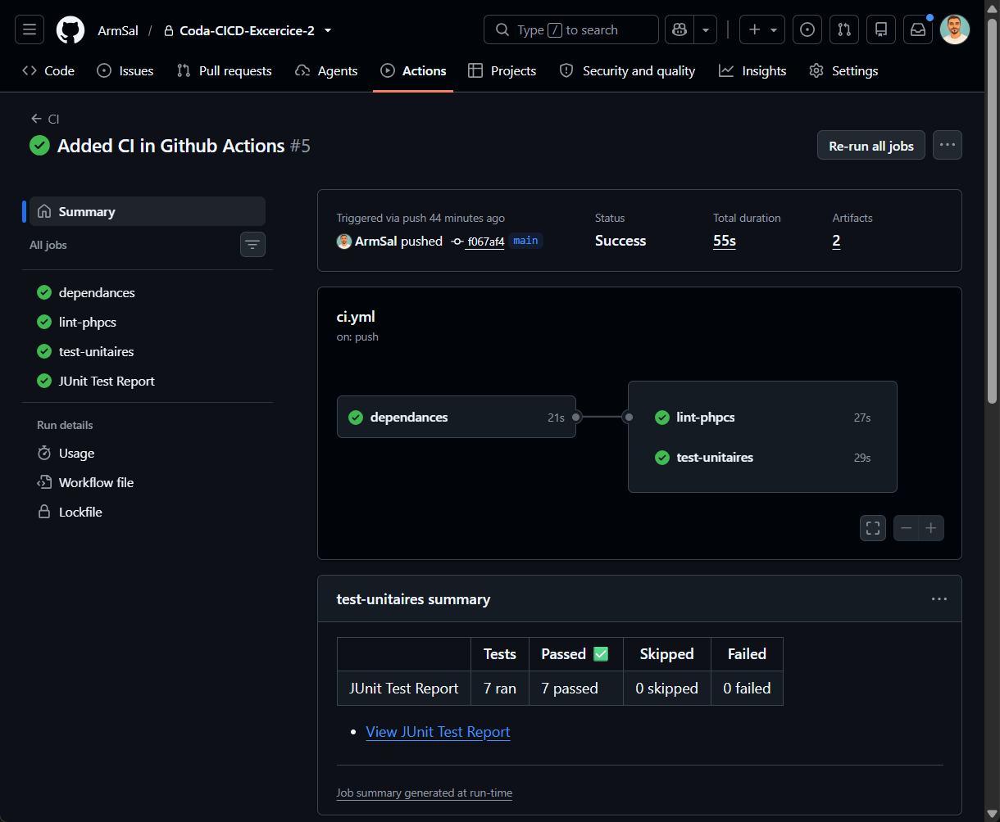

Log de dependances au second pipeline : le cache est restauré et l'artifact vendor est envoyé :

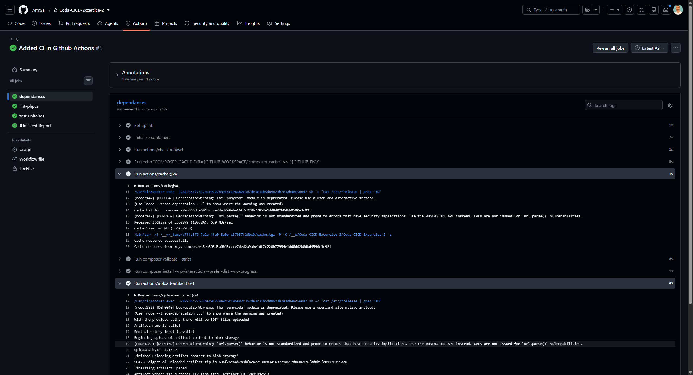

Le pipeline rouge : test-unitaires échoue, le rapport JUnit indique le test en échec :

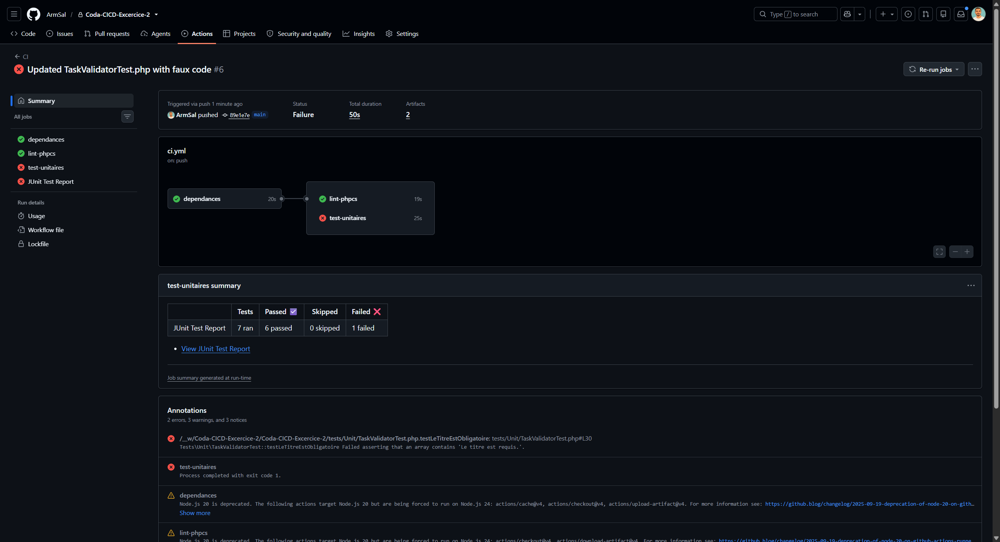

Le README du projet avec le badge de pipeline :

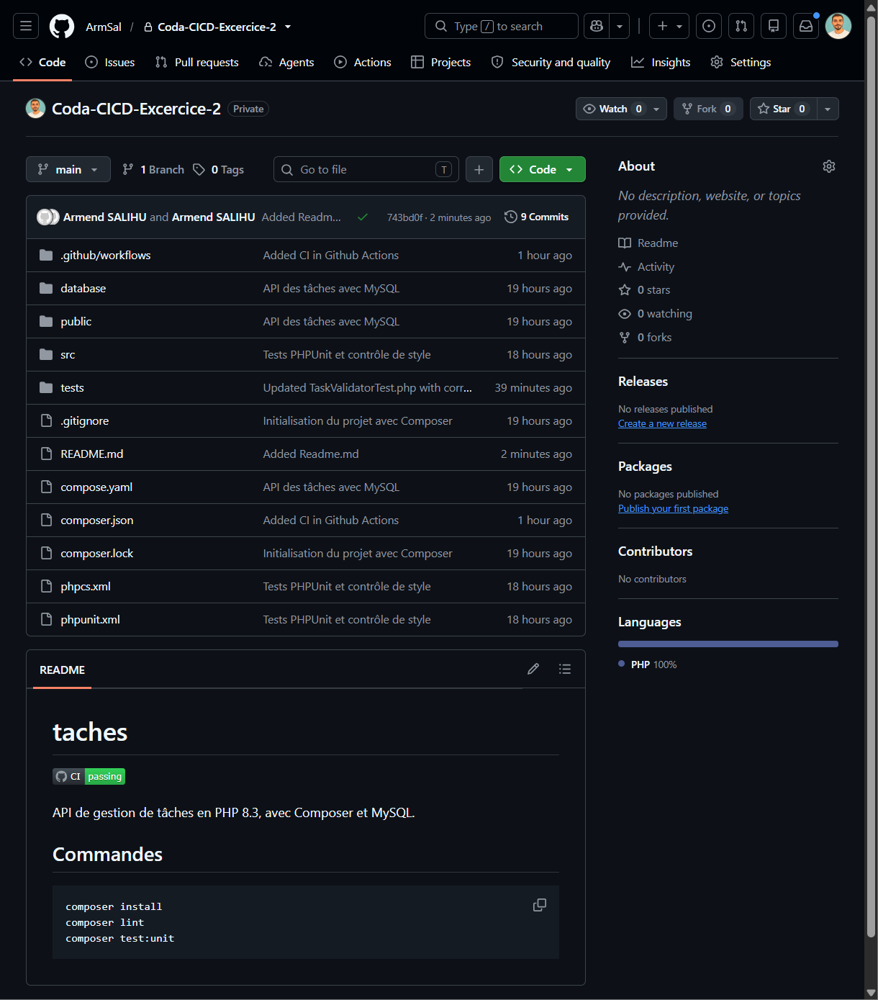

Premier pipeline vert : https://github.com/ArmSal/Coda-CICD-Excercice-2/actions/runs/39926746490

### Mon pipeline

J’ai créé mon pipeline dans .github/workflows/ci.yml. Il a trois jobs : un pour installer les paquets, un pour vérifier le code et un pour lancer les tests. Les deux derniers tournent en parallèle.

Au premier push, Composer a trouvé un problème de versions. J’ai remplacé 11.5 et 3.11 par ^11.5 et ^3.11. Après, le pipeline est passé au vert.

### Questions

**1. Quelle est la différence entre un artifact et le cache ? Pourquoi vendor/ est-il un artifact et .composer-cache/ un cache ?**

Un artifact sert à partager des fichiers entre les jobs. vendor/ contient les paquets nécessaires aux tests. Le cache .composer-cache/ évite de télécharger les paquets à nouveau et fait gagner du temps.

**2. Que change needs: [dependances] ? Que se passerait-il sans artifact ?**

Les deux autres jobs attendent la fin de dependances, puis démarrent en parallèle. Sans télécharger l’artifact vendor/, ils doivent refaire composer install pour fonctionner.

**3. Qu'avez-vous observé avec allow_failure: true ? Pourquoi ne faut-il pas en abuser ?**

Le lint peut échouer, mais le pipeline reste vert. Il faut faire attention : on peut oublier les erreurs et livrer du code avec des problèmes

## Module 5 : tests d'intégration en CI avec un service MySQL

### Captures

Le job test-integration sans l'extension : les 4 tests d'intégration échouent avec « PDOException: could not find driver » :

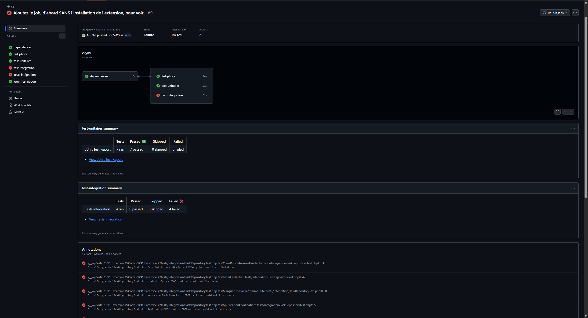

Le job sans DB_HOST : l'application cherche MySQL sur 127.0.0.1, Connection refused :

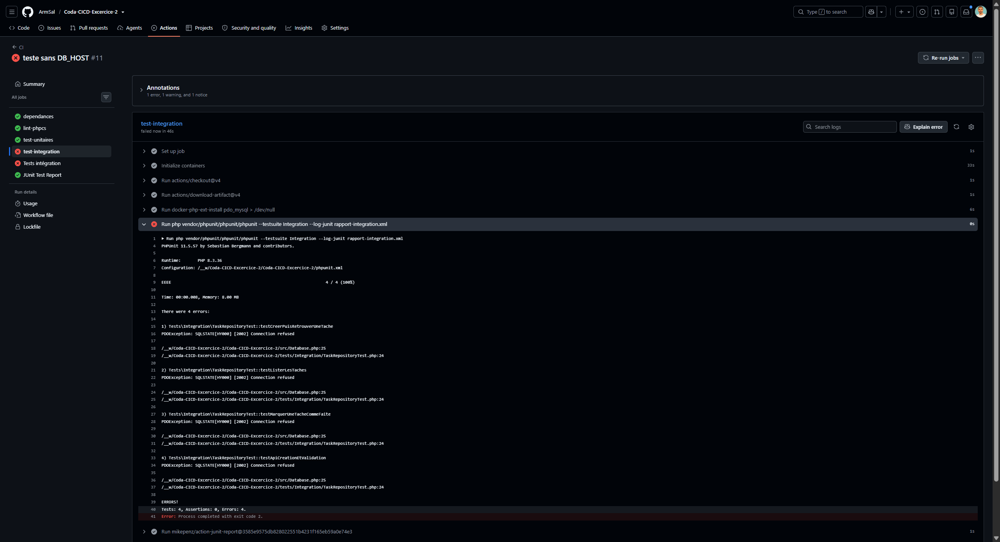

Le pipeline vert avec ses 4 jobs (dependances, lint-phpcs, test-unitaires, test-integration) :

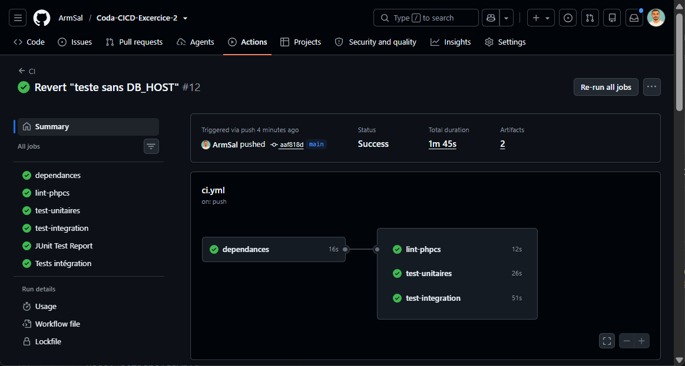

Le résumé des tests : deux suites, « JUnit Test Report » (7 tests unitaires) et « Tests intégration » (4 tests) :

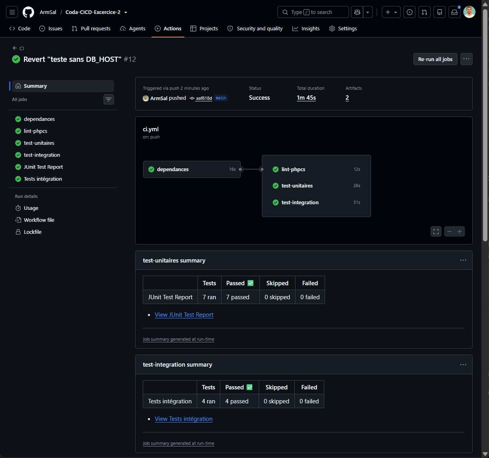

Premier pipeline vert avec les 4 jobs : https://github.com/ArmSal/Coda-CICD-Excercice-2/actions/runs/39944484045

### Mon job

J’ai ajouté le job `test-integration` avec PHP et un service MySQL.

Au début, les 4 tests marchait pas. J’ai ajouté `pdo_mysql` et `DB_HOST: mysql`. Après, les 4 tests ont réussi.

Installer `pdo_mysql` prend 4 à 6 secondes. Démarrer les conteneurs prend environ 33 secondes.

### Questions

**1. Pourquoi 127.0.0.1 ne fonctionne-t-il pas dans le job, alors qu'il fonctionne sur votre machine ?**

Dans le job, cette adresse pointe vers le conteneur PHP. MySQL est dans un autre conteneur, donc j’utilise `mysql` comme adresse.

**2. Pourquoi les mêmes variables servent-elles à la fois au service MySQL et à l'application ?**

MySQL crée la base et l’utilisateur avec ces valeurs. L’application doit utiliser les mêmes pour se connecter. Sinon, la connexion marche pas.

**3. Vos deux propositions pour éviter de recompiler pdo_mysql à chaque fois, avec la durée gagnée.**

Je peux créer une image PHP avec `pdo_mysql` déjà installé, ou utiliser `shivammathur/setup-php` sur le runner avec cette extension. Ça peut faire gagner environ 4 à 6 secondes par lancement.

## Module 6 : build de l'image Docker et publication dans le registre

### Captures

Le build local de l'image (docker compose up -d --build) : build réussi, MySQL healthy, /health répond {"status":"ok"} et /tasks renvoie les tâches :

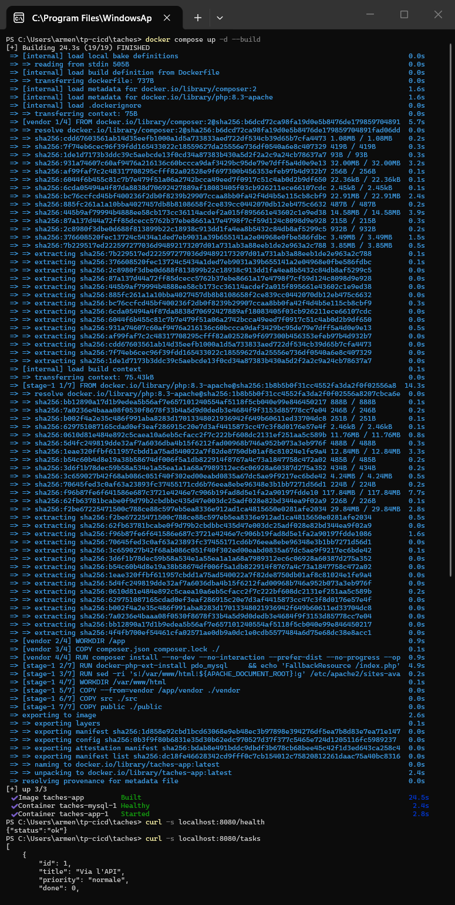

Le pipeline de main avec ses 5 jobs verts (dependances, lint-phpcs, test-unitaires, test-integration, build-image) :

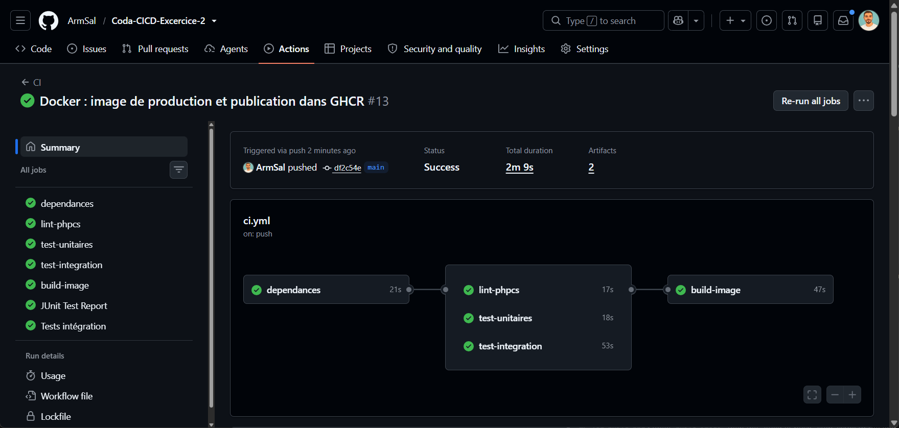

La fin du log de build-image : toutes les couches sont poussées (Pushed) vers ghcr.io :

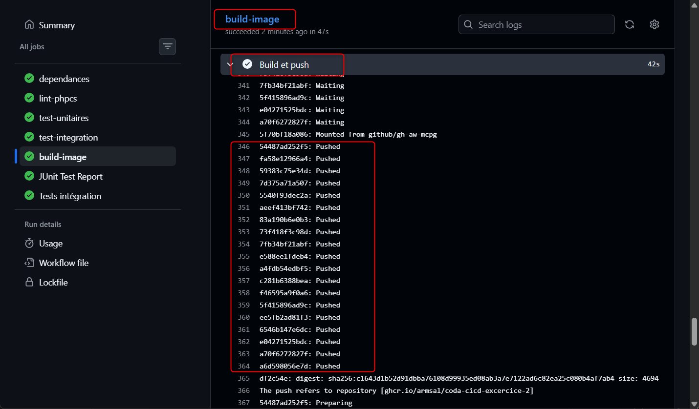

Le pipeline de la branche essai-rules : build-image est ignoré (skipped), il n'y a pas de publication :

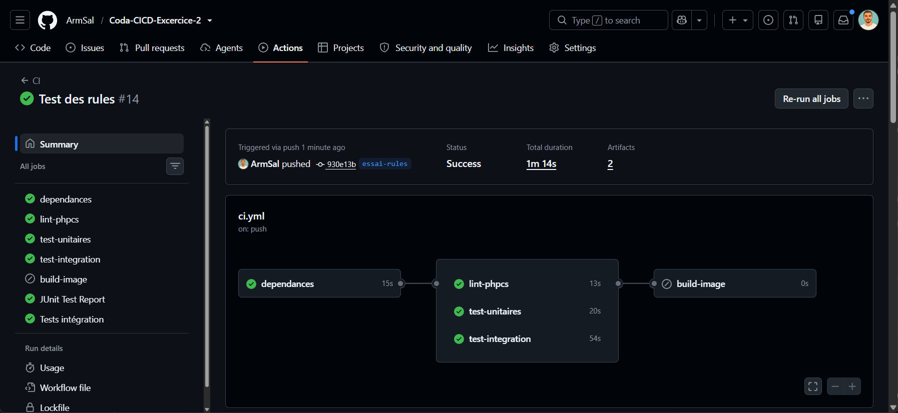

Le registre GitHub (GHCR) avec les tags latest, df2c54e (le SHA du commit) et v1.0.0 :

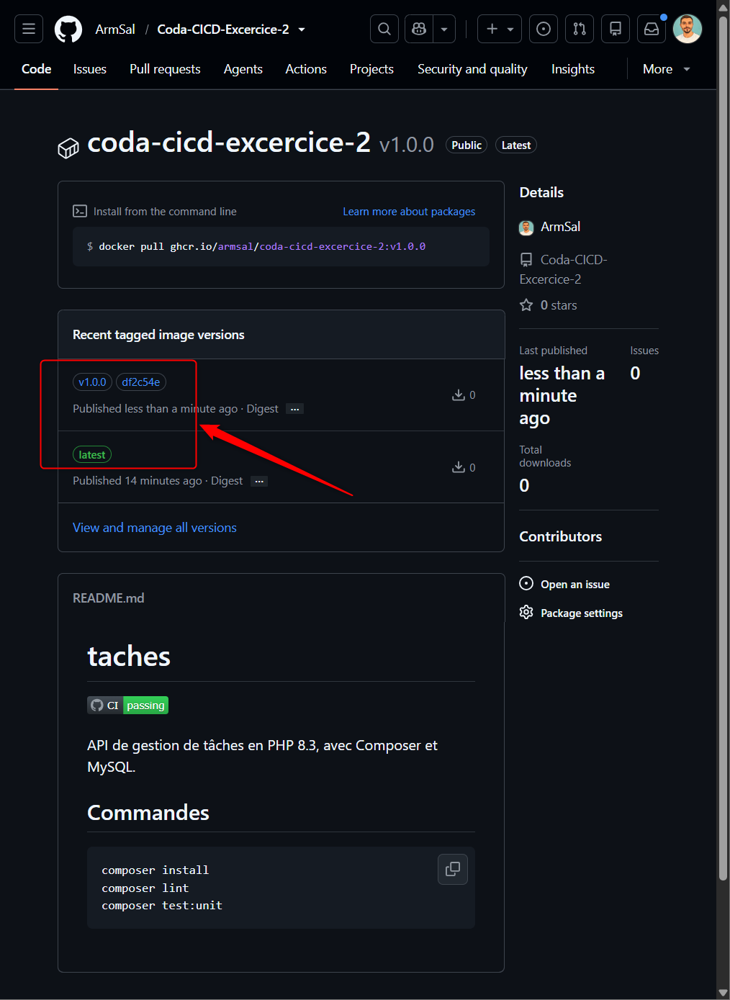

### Image publiée

Avec les tags df2c54e (SHA court du commit), latest et v1.0.0. Exemple : docker pull ghcr.io/armsal/coda-cicd-excercice-2:v1.0.0*

https://github.com/ArmSal/Coda-CICD-Excercice-2/pkgs/container/coda-cicd-excercice-2,

Pipeline de main : https://github.com/ArmSal/Coda-CICD-Excercice-2/actions/runs/39948578818 ;

Pipeline de la branche essai-rules : https://github.com/ArmSal/Coda-CICD-Excercice-2/actions/runs/39949346543

pipeline du tag v1.0.0 : https://github.com/ArmSal/Coda-CICD-Excercice-2/actions/runs/39950250181

### Mon job

J’ai créé un Dockerfile en deux étapes et un .dockerignore.

Le job build-image construit et publie l’image sur GHCR, seulement sur main et les tags.

Sur essai-rules, le job se lance pas. Avec v1.0.0, l’image est publiée avec les tags df2c54e et v1.0.0.

Mon image fait 713 MB.

### Questions

**1. Pourquoi un Dockerfile multi-étapes ? Qu'est-ce qui n'est pas dans l'image finale, et pourquoi est-ce mieux ?**

La première étape installe les paquets. La deuxième garde seulement ce qui est utile pour l’application. Composer, PHPUnit et les tests sont pas dans l’image finale.

**2. Pourquoi taguer les images avec le SHA du commit plutôt qu'uniquement avec latest ?**

latest peut changer. Le SHA permet de retrouver le code exact et de revenir à une ancienne version.

**3. Que faudrait-il ajouter pour déployer ? En GitOps, quel serait le rôle exact de la CI ?**

Il faut un serveur et un outil de déploiement. En GitOps, la CI change le tag dans le dépôt de configuration. Ensuite, Argo CD fait le déploiement.

## TP final : une fonctionnalité livrée par pull request

### Captures

Le push direct sur main est refusé :

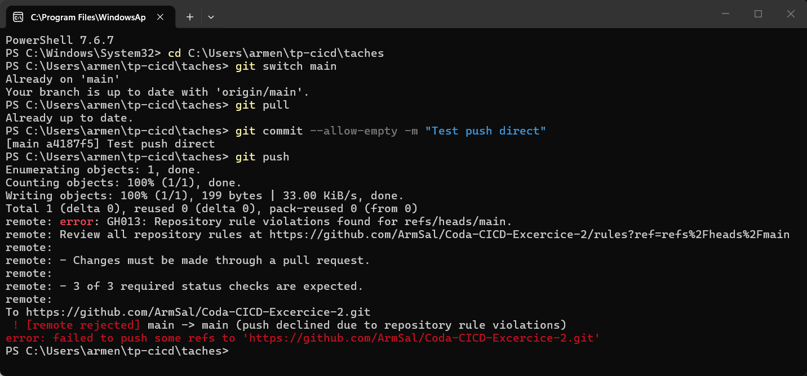

La pull request #2, avec le commentaire de relecture et les checks verts :

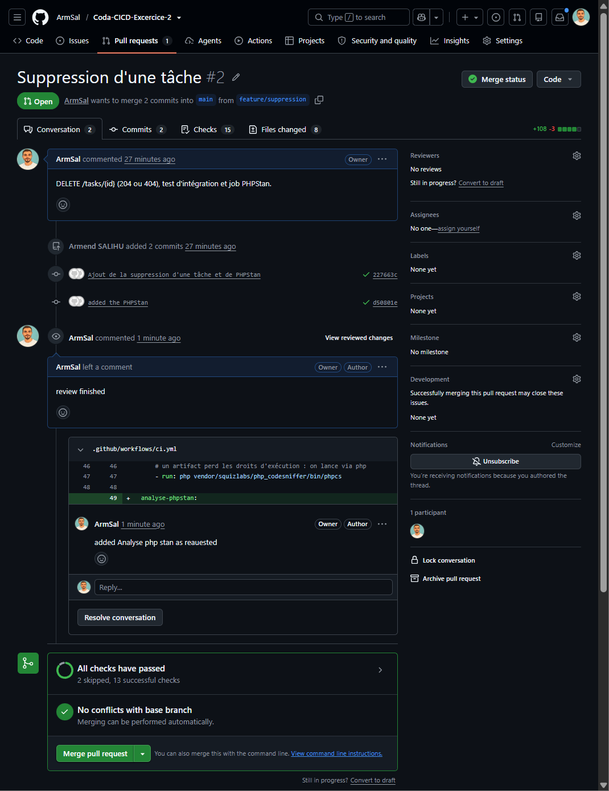

Le pipeline de la pull request, avec le job analyse-phpstan :

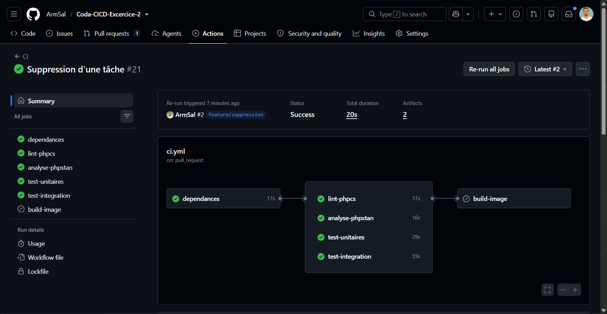

La nouvelle image dans le registre après la fusion (tags latest et b6514e3) :

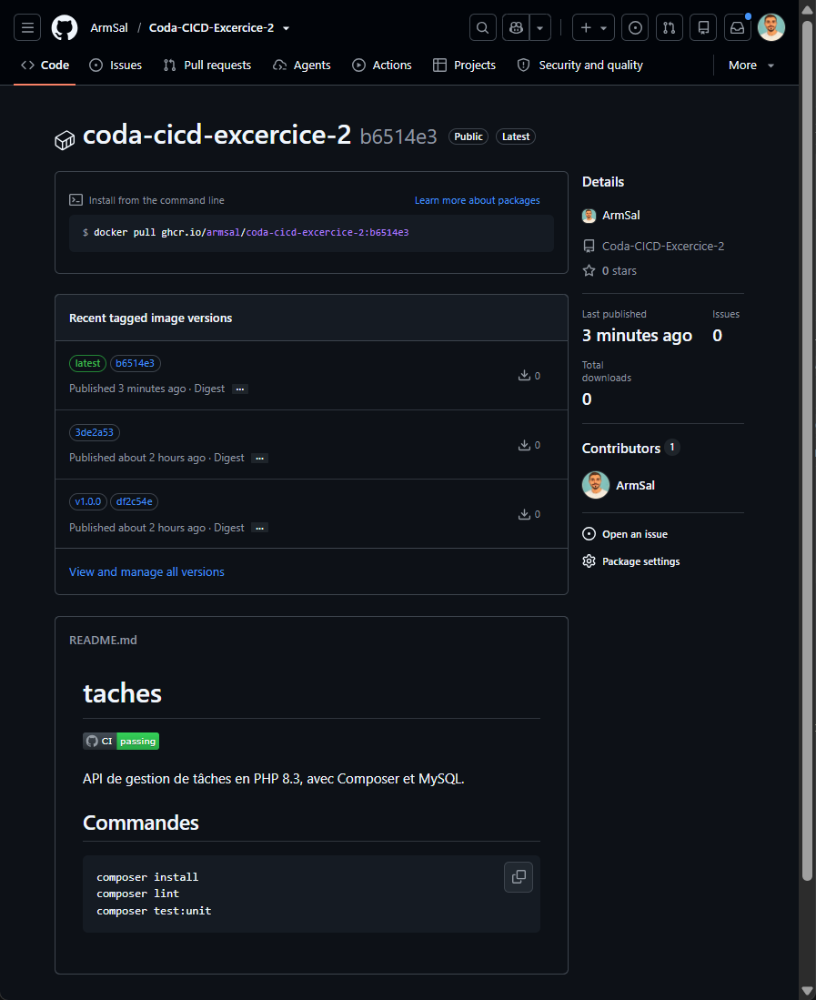

curl -X DELETE : 204 la première fois, puis 404 :

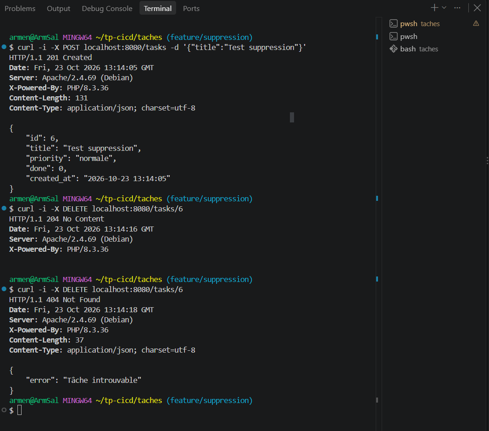

URL de la pull request : https://github.com/ArmSal/Coda-CICD-Excercice-2/pull/2

### Mon travail

**Ce que j'ai fait :**

J’ai protégé la branche main. Maintenant, on peut pas pousser directement. Il faut faire une pull request et les checks doivent être vert.

J’ai ajouté DELETE /tasks/{id} pour supprimer une tâche.

L’API répond 204 si la tâche est supprimé et 404 si elle existe pas. J’ai aussi ajouté un test d’intégration.

J’ai ajouté PHPStan niveau 6 et le job analyse-phpstan dans la CI.

Après le merge, la CI a publié la nouvelle image.

**Une difficulté :**

Ma difficulté : le test avec curl dans PowerShell.

La commande curl.exe --% -s -X POST localhost:8080/tasks -d "{\"title\":\"Test suppression\"}" ne marchait pas : l'API répondait « Le titre est obligatoire », car PowerShell change les guillemets du JSON.

Je suis allé dans Git Bash et la commande avec des apostrophes a marché (201).

**Avec plus de temps :**

avec plus de temp je veux faire les version GitLab aussi.
